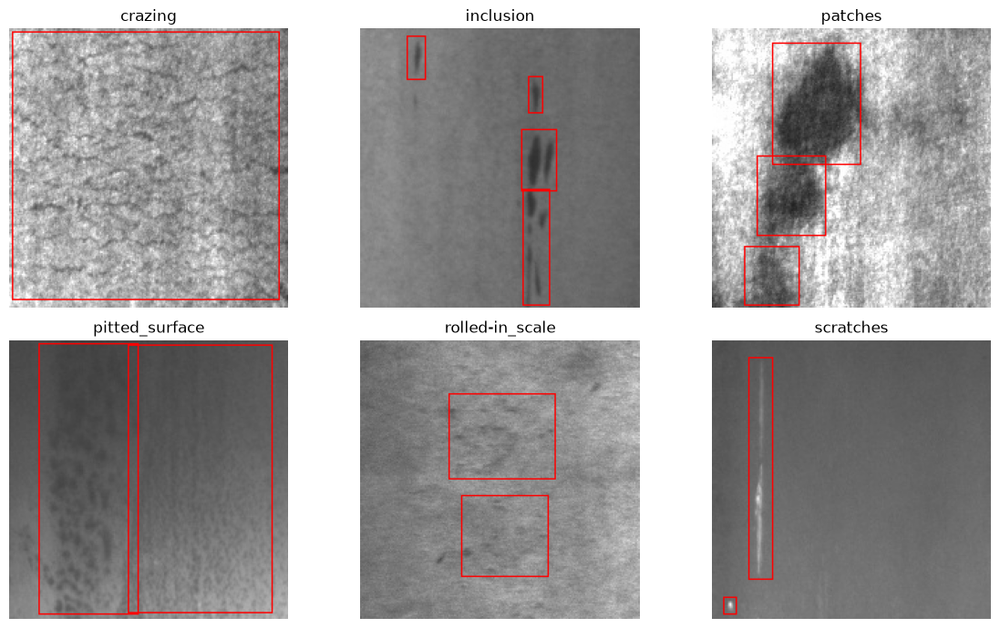
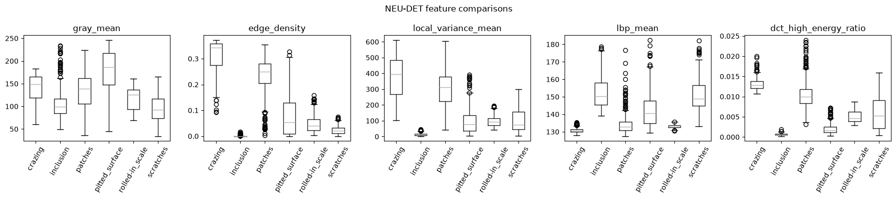
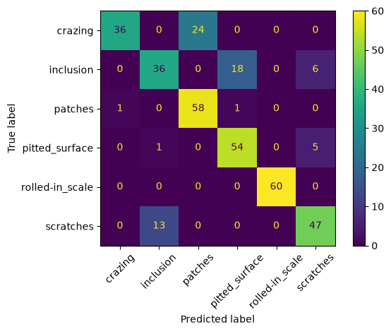
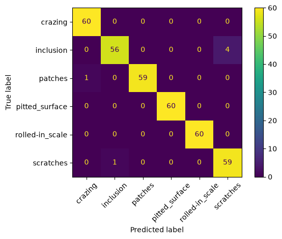
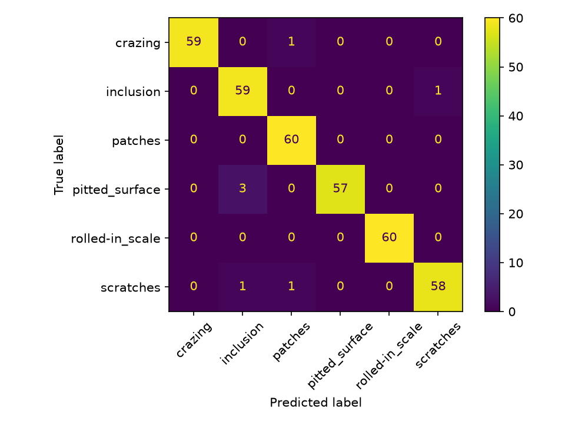

# Industrial Steel Surface Defect Classification Using Image Analytics and CNNs

## Project Report

**Project domain:** Industrial image analytics and automated visual inspection  
**Dataset:** NEU Surface Defect Database (NEU-DET)  
**Task:** Six-class steel surface defect classification  

## Abstract

Automated visual inspection can help manufacturers identify surface defects consistently and at scale. This project studies a staged image analytics workflow for classifying steel surface defects from the NEU Surface Defect Database (NEU-DET). It begins with image representation and dataset inspection, then extracts interpretable intensity, edge, texture, frequency-domain, and morphology measurements. These measurements support classical machine learning and guide CNN input design. Three neural approaches are considered: a grayscale CNN, an analytics-assisted CNN with grayscale, DCT, and morphology image channels, and a feature-fusion CNN that combines those image channels with the numerical feature table.

The dataset contains 1,800 images across six defect categories: 1,440 training images and 360 validation images. In the recorded runs, Random Forest reached 98.33% validation accuracy, the grayscale CNN reached a best recorded validation accuracy of 88.61%, the analytics-assisted CNN reached 98.33%, and the feature-fusion CNN reached a best recorded 98.61% (98.06% at its final epoch). The fusion model's best score is only 0.28 percentage points above the analytics-assisted CNN. Because the results come from single runs on one validation split, they indicate promising performance on this dataset rather than reliable superiority or production readiness.

## 1. Introduction

Steel surface quality affects the performance, appearance, and reliability of manufactured products. Defects may be subtle, vary in shape and texture, and occur at different scales. Visual inspection by people can be time-consuming and inconsistent, motivating computer vision methods that can classify defect types automatically.

Deep learning can learn visual patterns from images, while classical image analytics provides explicit measurements such as brightness, edge density, texture, and frequency energy. This project combines these perspectives. The analytics stages explain what differs between defect categories and provide structured inputs for machine-learning models. CNN experiments then test whether these representations support accurate image classification.

The project addresses image-level classification: each input image is assigned one of six defect labels. It does not claim pixel-level defect segmentation or localization performance. The dataset includes bounding-box annotations, which are inspected for correspondence and shown with sample images, but the classification models do not use annotation boxes as prediction inputs.

## 2. Aim and objectives

### Aim

To investigate how classical image analytics can support CNN-based classification of steel surface defects.

### Objectives

1. Inspect the dataset structure, image representation, and annotation correspondence.
2. Compare color models and basic preprocessing operations.
3. Extract interpretable intensity, edge, texture, DCT, and morphology features.
4. Evaluate the feature table with classical machine-learning classifiers.
5. Establish a grayscale CNN baseline.
6. Add DCT and morphology-derived image channels to an analytics-assisted CNN.
7. Fuse image-channel representations with the numerical feature table and compare validation results.

## 3. Dataset and defect classes

NEU-DET contains 1,800 steel surface images at 200 × 200 pixels. The project uses the provided training and validation partitions. The file inventory reports 240 training images and 60 validation images in each class. Images are JPG files. Although the files decode as three-channel images, their visual content is close to grayscale; grayscale therefore serves as the primary analysis representation.

| Class | Typical visual characteristics |
|---|---|
| Crazing | Fine, network-like cracks or lines across the surface |
| Inclusion | Irregular embedded or foreign-material regions |
| Patches | Broad areas with a different surface appearance |
| Pitted surface | Local pit-like marks or depressions |
| Rolled-in scale | Scale-like patterns or marks on the surface |
| Scratches | Thin, elongated surface marks |

### Annotation check

Notebook 01 compares every image filename with the corresponding Pascal VOC XML annotation. All 360 validation images have matching XML files. In the training split, all images match except `crazing_240.jpg`; this single file has no matching annotation. The sample visualization overlays boxes for inspection. These boxes are not supplied to the classifiers and do not affect the analytical feature extraction.

## 4. Methodology

### 4.1 Image representation and basic operations

Notebook 00 compares RGB, grayscale, HSV, and Lab views. It plots RGB channel and grayscale histograms, and demonstrates Gaussian blur, Canny edge detection, and grayscale normalization. This establishes that the images have little meaningful color variation and motivates grayscale as the main representation. The alternative color spaces remain useful as comparisons, while edges and histograms make local structure and intensity distributions easier to inspect.

### 4.2 Dataset exploration and preprocessing demonstrations

Notebook 01 produces an inventory by split and category, checks annotation correspondence, visualizes representative images and bounding boxes, and records per-image grayscale intensity statistics. It also demonstrates thresholding followed by morphological opening and closing, and visualizes low- and high-frequency DCT components.

The morphology example shows that thresholding can create many irregular regions from the naturally textured steel surface. Opening removes some small components and closing fills some gaps, but the result is not a reliable defect mask. In later modelling, morphology is therefore a supporting representation rather than a standalone segmentation solution.

The DCT demonstration separates broad intensity structure from fine spatial detail. High-frequency coefficients can represent scratches, cracks, and texture, but also respond to ordinary surface texture and noise. DCT is treated as a complementary analytical view, not as a defect-specific detector by itself.

### 4.3 Numerical feature extraction

Notebook 02 builds one feature row per image. The table has 18 analytical values plus `split`, `category`, and `file` identifiers.

| Feature family | Table columns | Interpretation |
|---|---|---|
| Intensity | `gray_mean`, `gray_std`, `gray_min`, `gray_max` | Average brightness, brightness variation, and minimum/maximum pixel values |
| Edges | `edge_density`, `edge_mean` | Fraction of edge pixels and mean edge response from Canny processing |
| Local texture | `lbp_mean`, `lbp_std` | Mean and variation of local binary pattern codes around pixels |
| Neighborhood variation | `local_variance_mean`, `local_variance_std` | Mean and variation of local pixel variance, describing roughness and texture changes |
| GLCM | `glcm_contrast`, `glcm_homogeneity`, `glcm_energy` | Contrast, similarity, and regularity of neighboring gray-level pairs |
| DCT | `dct_low_energy_ratio`, `dct_high_energy_ratio` | Fractions of squared DCT coefficient energy in low- and high-frequency regions |
| Morphology | `morphology_region_count`, `morphology_largest_area`, `morphology_foreground_ratio` | Count and size of connected thresholded regions and the fraction of foreground pixels |

For GLCM, grayscale values are reduced to 16 levels and horizontal neighboring pixel pairs are counted. DCT energy is computed from squared coefficients; low-frequency energy comes from the top-left 32 × 32 coefficient block and high-frequency energy is the remaining energy. Morphology measurements are calculated after inverse Otsu thresholding, opening, and closing, followed by connected-component analysis.

The feature comparison plot displays category distributions for grayscale mean, edge density, local variance, LBP mean, and high-frequency DCT energy. These plots show why multiple feature families are useful: brightness, boundaries, texture, and frequency describe different aspects of the defects. Within-class variability remains visible, so individual features should not be expected to cleanly separate all classes on their own. Morphology values are especially sensitive to thresholding and may measure background surface texture as well as defect structure.

### 4.4 Classical machine learning

The numerical feature table provides the input for Logistic Regression and Random Forest in the classical ML workflow. These models evaluate whether the engineered measurements alone can classify defect categories. The tracked model-comparison CSV reports Logistic Regression at 95.83% and Random Forest at 98.33% validation accuracy. The Random Forest result suggests that nonlinear combinations of the analytical features are useful on this split.

The current working tree has deletions for the classical confusion matrices and feature-importance plot. Consequently, this report discusses the saved numerical accuracy comparison but does not infer class-specific errors or rank individual features using those unavailable plots.

### 4.5 CNN model designs

#### Model A: Grayscale CNN

Notebook 04 loads each image as a single grayscale channel, converts pixels to tensors, and normalizes them. Two convolution blocks with ReLU activations and max pooling learn spatial patterns. A dense classifier maps the learned representation to six output classes. Training uses cross-entropy loss and the Adam optimizer with a learning rate of 0.001 for ten epochs.

#### Model B: Analytics-assisted CNN

Notebook 05 constructs three aligned channels for each image:

1. **Grayscale:** normalized original brightness and surface appearance.
2. **High-frequency DCT:** magnitude of the DCT after removing a low-frequency coefficient block, then normalized to an image channel.
3. **Morphology response:** inverse Otsu threshold response refined by 3 × 3 opening and closing.

The three channels are supplied to a CNN with the same general convolutional classifier structure and ten-epoch schedule. The model can learn from original appearance alongside frequency detail and thresholded structural patterns.

#### Model C: Feature-fusion CNN

Notebook 06 extends Model B with a numerical feature branch:

```text
Grayscale + DCT + morphology images → CNN branch ─┐
                                                  ├→ concatenate → six-class classifier
18 numerical analytical features → dense branch ─┘
```

The image branch maps the three-channel image to a learned vector. The numerical branch maps the 18 feature values through a dense layer and ReLU activation. The vectors are concatenated and passed to the final classifier. A `StandardScaler` is fitted on training rows and then applied to the feature table, avoiding the use of validation statistics when estimating scaling parameters. The fused model uses cross-entropy loss and Adam.

### 4.6 Evaluation protocol

The notebooks report validation accuracy and confusion matrices; classification reports provide precision, recall, and F1-score for CNN models. There are 360 images in the validation partition. CNN histories record accuracy for each of ten epochs. For comparison, this report presents the best recorded validation accuracy for each CNN when available and separately identifies the fusion model's final-epoch accuracy.

These scores are from individual training runs. The validation split is used repeatedly for model comparison and epoch selection, so it is not an untouched test set. No confidence intervals or repeated-seed averages are available in the current outputs.

## 5. Results and findings

### 5.1 Dataset and image analytics findings

- The dataset is balanced across six classes, with 240 training and 60 validation images per category.
- All images are 200 × 200 JPG files and visually close to grayscale.
- Validation annotations are complete; one training image, `crazing_240.jpg`, is missing its matching XML file.
- Histograms and intensity summaries show differences in brightness and contrast, alongside variation within categories.
- Edge density and local variance capture different surface characteristics from brightness alone.
- LBP, GLCM, and local variance provide complementary texture descriptions.
- DCT ratios summarize broad versus fine-frequency energy, while morphology descriptors summarize thresholded connected regions.
- Morphological opening and closing alter noisy threshold responses but do not reliably isolate defects in these images.

### 5.2 Model results

| Model | Input | Best recorded validation accuracy | Final recorded epoch accuracy | Notes |
|---|---|---:|---:|---|
| Logistic Regression | 18 numerical image features | 95.83% | Not recorded in the summary file | Classical linear baseline |
| Random Forest | 18 numerical image features | 98.33% | Not recorded in the summary file | Strong nonlinear feature-based baseline |
| Grayscale CNN | Grayscale image | 88.61% | 80.83% | Best at epoch 7; accuracy fluctuated across epochs |
| Analytics-assisted CNN | Grayscale, DCT, morphology channels | 98.33% | 98.33% | Reached the reported value at epoch 10 |
| Feature-fusion CNN | Three image channels plus 18 numerical features | 98.61% | 98.06% | Best at epoch 9; final epoch slightly lower |

The fusion CNN's best recorded validation accuracy is 0.28 percentage points above the analytics-assisted CNN and Random Forest. Its final-epoch accuracy is 0.27 percentage points below them. This small difference does not show that fusion provides a stable improvement. Repeated runs and a consistent checkpoint-selection procedure are required to determine whether the numerical branch adds a reliable benefit.

The grayscale CNN shows larger epoch-to-epoch variation than the other reported CNN runs. Its best score is substantially lower than the analytics-assisted CNN result, suggesting that the additional channels coincided with improved performance in these runs. Because there is no controlled channel ablation or repeated-seed experiment, the individual contributions of DCT and morphology cannot be isolated from the current evidence.

### 5.3 Comparison and interpretation

The classical ML results show that compact analytical features can be highly discriminative for this dataset. The grayscale CNN learns spatial patterns directly from image pixels, but its recorded training run was less consistent. The analytics-assisted CNN combines grayscale appearance with frequency and structural image responses and achieved the same validation accuracy as Random Forest. The feature-fusion CNN adds the measured table values to those image channels and reached the highest recorded best-epoch score, although the gain is very small and the final epoch did not retain it.

The project therefore demonstrates a plausible role for image analytics in CNN design: measurements can explain category differences and can be converted into additional representations or numerical inputs. The available results support further study of feature fusion, but do not yet establish that it generalizes better than the other approaches.

## 6. Selected figures

The following plots directly support the report's main findings: dataset appearance and annotation examples, representative feature differences, and the performance/error patterns of the principal CNN models.











## 7. Conclusion

This project built an image analytics workflow for six-class steel surface defect classification. Basic representation analysis supported grayscale processing. Intensity, edge, texture, DCT, and morphology measurements produced an interpretable feature table, and Random Forest achieved 98.33% validation accuracy with that table. The grayscale CNN achieved a best recorded 88.61%; adding DCT and morphology image channels coincided with a 98.33% result. The feature-fusion CNN, which also receives the numerical measurements, achieved a best recorded 98.61% and a final-epoch score of 98.06%.

These results show that analytical image representations and numerical descriptors are promising inputs for CNN classification on NEU-DET. The modest best-score difference from the other strong models requires repeated, controlled evaluation before concluding that feature fusion is superior. The work is a classification study and does not establish production readiness or defect localization performance.

## 8. Reproducibility and project files

Place the dataset under `dataset/NEU-DET/` with `train/images`, `train/annotations`, `validation/images`, and `validation/annotations`. Install OpenCV, NumPy, Pandas, Matplotlib, scikit-learn, PyTorch, and Jupyter in the selected Python environment. Run the current notebooks in sequence: 00, 01, 02, 04, 05, and 06. Notebook 02 generates the feature table required by Notebook 06. Each notebook writes generated files under `outputs/`.

Current analysis notebooks:

- `00_neu_basic_image_analytics.ipynb` — color models, histograms, and basic operations
- `01_neu_dataset_exploration1.ipynb` — inventory, annotations, intensity, morphology, and DCT demonstrations
- `02_neu_feature_analytics2.ipynb` — numerical feature extraction and comparisons
- `04_neu_cnn_baseline.ipynb` — grayscale CNN
- `05_neu_analytics_assisted_cnn.ipynb` — three-channel analytics-assisted CNN
- `06_neu_review3_feature_fusion.ipynb` — CNN and feature-table fusion

The dataset is excluded from this repository. Selected PNG figures are tracked; generated tables, training histories, and model weights are created locally by running the notebooks.

## Dataset attribution

The project does not redistribute the NEU-DET dataset. Users should obtain it from its provider and follow the associated terms for access, use, attribution, and redistribution.
