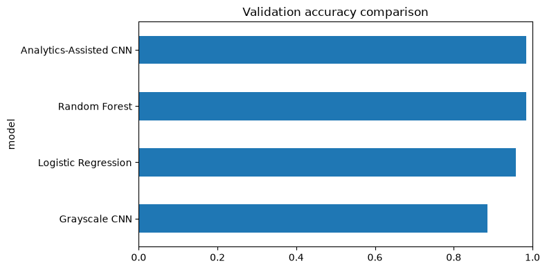
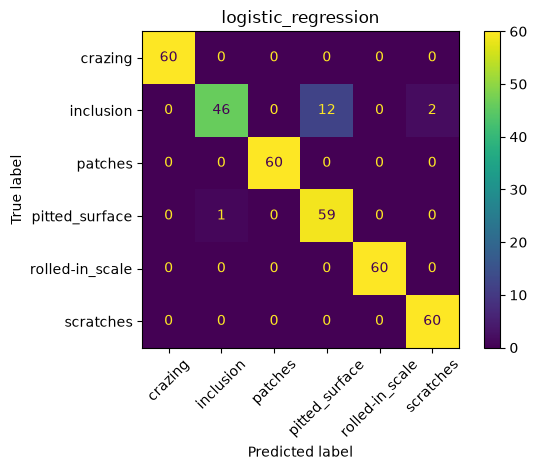
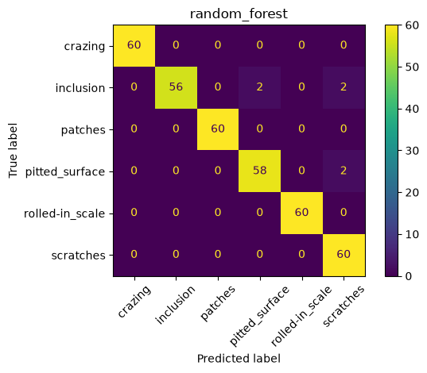
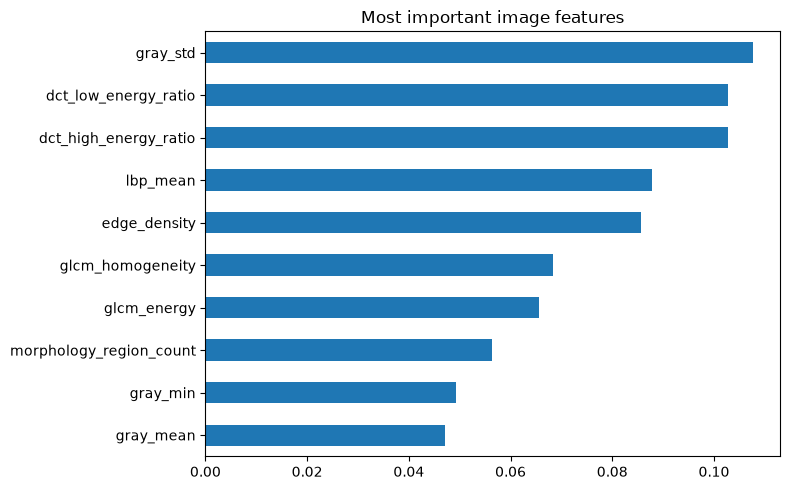
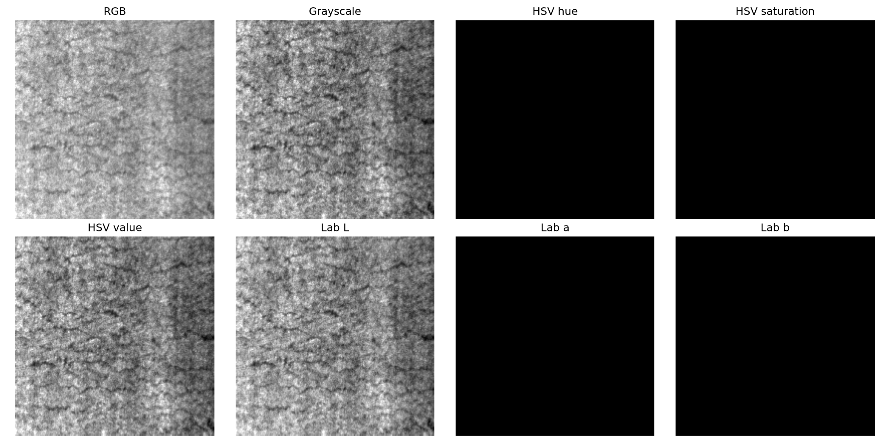
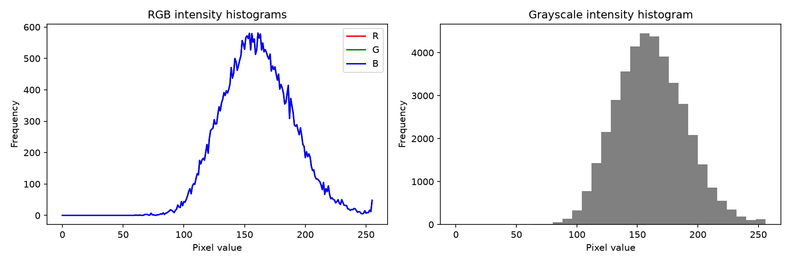
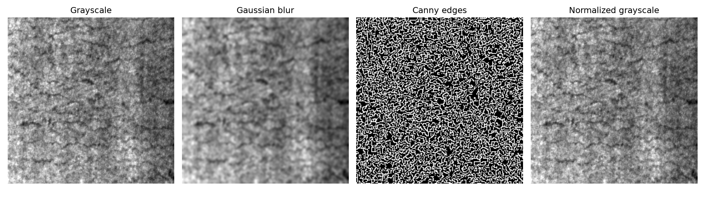
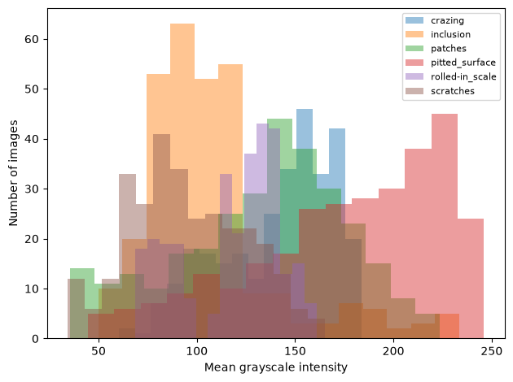
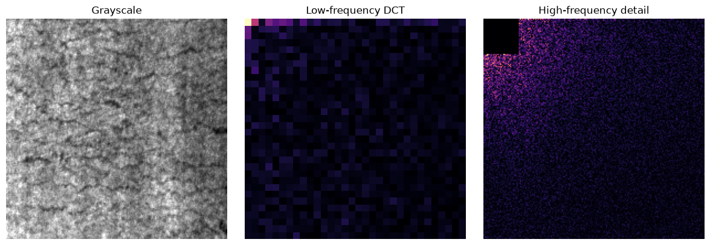
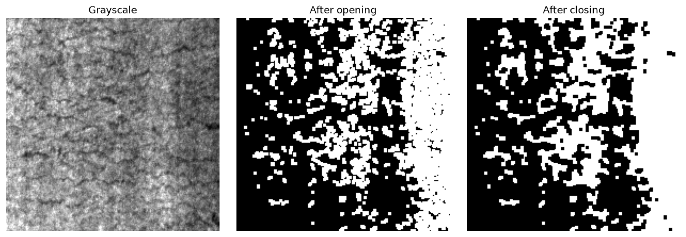

# Project Report: Steel Surface Defect Classification with Image Analytics and CNNs

## Abstract

This project studies image analytics for automated classification of steel surface defects using the NEU Surface Defect Database (NEU-DET). It combines interpretable image measurements with classical machine learning and convolutional neural networks (CNNs). The work explores intensity, edges, texture, frequency-domain information from the Discrete Cosine Transform (DCT), and structural information from morphological operations. It then compares a grayscale CNN, an analytics-assisted CNN, and a CNN that fuses image channels with a numerical feature vector.

The dataset contains 1,800 images across six defect categories: 1,440 training images and 360 validation images. In the recorded experiments, Random Forest and the analytics-assisted CNN each reached 98.33% validation accuracy. The grayscale CNN reached a best recorded validation accuracy of 88.61%. A separate feature-fusion notebook is included for Review 3; its tracked confusion matrix is shown below, but its accuracy is not included in the recorded model-comparison table, so no fusion score is asserted here.

## 1. Project aims

- Explore how digital image representation and basic image operations describe steel surface appearance.
- Extract intensity, edge, texture, frequency, and morphology measurements.
- Compare classical ML models trained on the extracted feature table.
- Evaluate CNN classification using raw grayscale and analytics-derived image channels.
- Extend the analytics-assisted CNN by fusing a numerical feature vector with learned image features.
- Interpret model errors and explain the role of each analytical representation.

## 2. Dataset and product

The project uses NEU-DET, a collection of grayscale steel surface images. Each image is 200 × 200 pixels. The six classes are:

| Class | Description |
|---|---|
| Crazing | Fine crack-like or network patterns |
| Inclusion | Irregular embedded or foreign material regions |
| Patches | Broad regions with a different surface pattern |
| Pitted surface | Pit-like marks and local surface depressions |
| Rolled-in scale | Scale-like patterns associated with rolling |
| Scratches | Thin, elongated surface marks |

The project uses the dataset's training and validation splits. The validation split contains 60 examples per class. Dataset images and annotation files are not stored in this repository; annotations are inspected for correspondence and may support evaluation, but are not prediction inputs.

## 3. Workflow

```text
Dataset inspection
        ↓
Basic image representation and preprocessing
        ↓
Intensity, edge, texture, DCT, and morphology analytics
        ↓
Feature table ──────────────→ Logistic Regression / Random Forest
        ↓
Grayscale CNN ──────────────→ validation comparison
        ↓
Grayscale + DCT + morphology channels ─→ analytics-assisted CNN
        ↓
Image-channel CNN + numerical feature vector ─→ Review 3 fusion CNN
```

## 4. Image analytics

### 4.1 Representation and preprocessing

The basic analytics notebook compares RGB, grayscale, HSV, and Lab representations, displays color-channel and grayscale histograms, and demonstrates Gaussian blur, Canny edges, and normalization. The dataset is visually close to grayscale, so grayscale carries the main appearance information. HSV and Lab are included as color-model comparisons rather than assumed to provide additional signal.

### 4.2 Intensity and edges

For each image, grayscale summaries include mean, standard deviation, minimum, and maximum pixel values. Canny edge processing supplies edge density and edge response measurements. These describe brightness, contrast, and the amount of local boundary-like structure.

### 4.3 Texture

- **LBP (Local Binary Pattern):** summarizes local neighborhood patterns and texture variation.
- **Local variance:** measures intensity variation in neighborhoods, indicating rough or irregular surface appearance.
- **GLCM (Gray-Level Co-occurrence Matrix):** measures neighboring gray-level relationships. The table includes contrast, homogeneity, and energy.

These measurements provide numeric ways to compare surface texture among defect classes.

### 4.4 DCT frequency analytics

The DCT maps image intensity into spatial-frequency coefficients. Low-frequency energy reflects broad brightness changes and large structures. High-frequency energy reflects fine changes such as edges and texture. The feature table includes low- and high-frequency energy ratios. The analytics-assisted CNN also receives a normalized high-frequency DCT representation as an image channel.

### 4.5 Morphological analytics

Thresholding converts an image into a binary response. Opening removes small isolated foreground components, while closing fills small gaps. Connected-component measurements summarize region count, largest area, and foreground ratio. Because steel texture can itself form many irregular regions, these measurements are exploratory structural cues and are not treated as precise defect segmentation.

## 5. Feature table

Notebook 02 produces one row per image with identifiers (`split`, `category`, `file`) and 18 numeric features:

| Group | Feature columns |
|---|---|
| Intensity | `gray_mean`, `gray_std`, `gray_min`, `gray_max` |
| Edges | `edge_density`, `edge_mean` |
| Texture | `lbp_mean`, `lbp_std`, `local_variance_mean`, `local_variance_std` |
| GLCM | `glcm_contrast`, `glcm_homogeneity`, `glcm_energy` |
| DCT | `dct_low_energy_ratio`, `dct_high_energy_ratio` |
| Morphology | `morphology_region_count`, `morphology_largest_area`, `morphology_foreground_ratio` |

The table supports category summaries and classical ML. In Review 3, its numerical columns are standardized using training-split statistics and passed through a dense feature branch. Identifiers and category labels are excluded from model inputs.

## 6. Models

### 6.1 Classical machine learning

Logistic Regression and Random Forest classify the numerical feature table. Their results provide a baseline and help show whether the hand-designed measurements separate defect categories.

### 6.2 Grayscale CNN

A small CNN learns spatial patterns directly from grayscale images. Convolutional layers learn local visual structures, and a classifier maps the learned representation to one of the six defect classes.

### 6.3 Analytics-assisted CNN

This CNN receives three aligned image channels:

1. Grayscale appearance
2. High-frequency DCT detail
3. Morphology response

The additional channels provide frequency and structural representations alongside the original appearance. They do not use annotation masks or labels to create predictions.

### 6.4 Review 3 feature-fusion CNN

The Review 3 model has two branches:

- An image CNN processes grayscale, DCT, and morphology channels.
- A dense/MLP branch processes the 18 normalized numeric features.

The branch outputs are concatenated and passed to a six-class classifier. The notebook uses cross-entropy loss and the Adam optimizer. Its purpose is to test whether the numerical measurements add value beyond the image channels. The fusion model's result should be compared using its own recorded validation report; the score should not be inferred from another model's run.

## 7. Results

### 7.1 Recorded validation accuracy

| Model | Validation accuracy |
|---|---:|
| Logistic Regression | 95.83% |
| Random Forest | 98.33% |
| Grayscale CNN | 88.61% best recorded epoch |
| Analytics-Assisted CNN | 98.33% |

The grayscale CNN fluctuated over the 10 recorded epochs: its best validation accuracy was 88.61% at epoch 7, while its final epoch was 80.83%. The analytics-assisted CNN rose to 98.33% at epoch 10. These are results from the recorded runs on the fixed validation split; they are not independent test-set estimates.

The feature-fusion CNN has a tracked confusion-matrix plot, but its CSV training history and model comparison score are not part of the Git-tracked results. Therefore, this report does not claim that feature fusion improved accuracy. Run Notebook 06 and record its validation metrics before making that conclusion.

### 7.2 Model comparison plot



### 7.3 Classical ML results

The Random Forest reached 98.33%, compared with 95.83% for Logistic Regression. This indicates that the feature table contains class-discriminating patterns and that nonlinear decision boundaries can be useful for this dataset.







### 7.4 CNN results

The grayscale CNN's validation performance varied across epochs. The analytics-assisted CNN reached the same best recorded accuracy as the Random Forest. This run suggests that the DCT and morphology channels provided useful complementary representations, though repeated controlled runs would be needed to quantify a robust improvement.


### 7.5 Feature-fusion result visualization


The confusion matrix visualizes the stored prediction result. To report a numerical score, use the validation accuracy and classification report produced by running the current Review 3 notebook; do not substitute the score from the analytics-assisted CNN.

## 8. Analytical visualizations

### Basic representations







### Dataset examples and processing








### Feature comparisons


These visualizations illustrate why multiple measurements are useful: defect categories differ in brightness, edge content, texture, frequency energy, and morphology-derived structure. Individual features do not necessarily separate every class on their own.

## 9. Interpretation

- The close-to-grayscale appearance makes grayscale a practical main input representation.
- Texture, edge, intensity, and DCT measurements provide interpretable evidence about category differences.
- Random Forest performs strongly on the extracted features for this validation split.
- The analytics-assisted CNN substantially exceeds the recorded grayscale CNN best score in this run.
- Morphology is useful as an additional structural response, but thresholded regions are noisy and should not be described as accurate defect masks without a dedicated segmentation evaluation.
- Review 3 is designed to test numerical feature fusion. Its value must be established through its recorded metrics and a fair comparison under consistent data splits and training conditions.

## 10. Limitations and next steps

- The dataset is small and has a fixed validation split; performance may not generalize to production images.
- Training results are stochastic and may change with initialization, hardware, and software versions.
- Results should be supported by repeated seeds or a held-out test set before making broad performance claims.
- The validation set is used for model comparison, so it should not be described as an untouched final test set.
- The feature-fusion notebook's metric needs to be run and recorded alongside the baseline under the same protocol.
- Future work could add repeated-run mean and standard deviation, per-class precision/recall/F1, and an ablation study that removes one analytical channel or feature group at a time.
- Localization would require a separate method and pixel-level evaluation; the classification scores in this report do not demonstrate defect localization.

## 11. Reproducibility

1. Place the NEU-DET dataset under `dataset/NEU-DET/` using the expected folder structure described in `README.md`.
2. Install the notebook dependencies in the selected Python environment.
3. Run notebooks 00, 01, and 02 to inspect the data and create the feature table.
4. Run notebooks 04 and 05 for the CNN baselines.
5. Run notebook 06 for the Review 3 feature-fusion experiment.
6. Preserve the generated validation reports and update this report if results change.

Notebook outputs are written under `outputs/`. The dataset is not distributed in this repository. The selected plots are tracked; tables, model weights, and most run-specific files are generated locally.

## 12. Project contents

- `notebooks/00_neu_basic_image_analytics.ipynb` — basic representations, histograms, and operations
- `notebooks/01_neu_dataset_exploration1.ipynb` — dataset inventory and exploratory processing
- `notebooks/02_neu_feature_analytics2.ipynb` — feature extraction and comparison
- `notebooks/04_neu_cnn_baseline.ipynb` — grayscale CNN baseline
- `notebooks/05_neu_analytics_assisted_cnn.ipynb` — three-channel analytics-assisted CNN
- `notebooks/06_neu_review3_feature_fusion.ipynb` — CNN and numerical feature fusion
- `README.md` — repository setup and quick start
